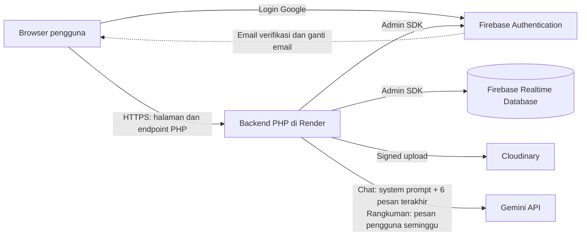

# Senara

Ruang tenang untuk jurnal harian, afirmasi, dan bercerita bersama Nomi.

Senara adalah website refleksi diri berbasis layanan cloud. Pengguna bisa membaca afirmasi harian, menulis jurnal lengkap dengan foto, melihat kembali jurnalnya di kalender arsip, dan bercerita kepada **Nomi**, teman bicara virtual yang hangat dan empatik (ditenagai Gemini API).

## Daftar Isi

- [Persyaratan Proyek](#persyaratan-proyek)
- [Fitur](#fitur)
- [Teknologi](#teknologi)
- [Arsitektur](#arsitektur)
- [Fungsi CRUD](#fungsi-crud)
- [Struktur Database](#struktur-database)
- [Menjalankan Secara Lokal](#menjalankan-secara-lokal)
- [Menjalankan dengan Docker](#menjalankan-dengan-docker)
- [Deploy ke Render](#deploy-ke-render)
- [Struktur Project](#struktur-project)
- [Keamanan](#keamanan)
- [Keputusan Desain](#keputusan-desain)
- [Tim](#tim)

## Persyaratan Proyek

Website ini dibangun untuk memenuhi persyaratan berikut:

- Berbasis layanan cloud, dengan **Firebase** sebagai layanan wajib.
- **12 fungsi CRUD** (3 Create, 3 Read, 3 Update, 3 Delete) yang terhubung ke **Firebase Realtime Database**.
- **Register dan login** menggunakan **Firebase Authentication**.
- **Web mailer** lewat Firebase: setelah register, pengguna menerima email verifikasi.

## Fitur

### Landing page

Slider 4 slide (Tentang Senara, contoh afirmasi harian, perkenalan Nomi, dan ajakan mendaftar). Bisa digeser dengan panah keyboard, sentuhan, mouse, atau touchpad.

### Registrasi dan login

- Daftar dengan **nama lengkap, email, dan kata sandi** (minimal 6 karakter), atau **Login with Google**.
- Setelah daftar, Firebase mengirim **email verifikasi**. Login dengan email baru bisa dilakukan setelah email diverifikasi. Akun Google dianggap sudah terverifikasi.
- Email verifikasi bisa dikirim ulang dari halaman Cek Email atau Login, dengan jeda 60 detik.
- *Email Enumeration Protection* aktif, sehingga akun yang tidak ditemukan dan kata sandi yang salah sama-sama ditampilkan sebagai "Email atau kata sandi salah".
- Semua halaman setelah login hanya bisa dibuka oleh pengguna yang sudah login.

### Dashboard

Sapaan dengan nama depan, afirmasi harian, dan **streak** (jumlah hari berturut-turut menulis jurnal) beserta status 7 hari minggu ini (Minggu sampai Sabtu).

**Rangkuman mingguan:** kartu "Kilasan Mingguanmu Bersama Nomi" berisi rangkuman 2–3 kalimat dan maksimal 3 tema dari chat dengan Nomi minggu lalu (Minggu sampai Sabtu, WIB). Rangkuman dibuat Gemini saat dashboard pertama kali dibuka mulai hari Senin, lalu disimpan dan tidak berubah sampai Senin berikutnya, sehingga Gemini dipanggil paling banyak sekali per pengguna per minggu. Jika chat minggu itu kurang dari 5 pesan, Gemini tidak dipanggil dan kartu mengajak pengguna ngobrol dengan Nomi. Rangkuman ikut terhapus saat riwayat chat dibersihkan.

### Afirmasi harian

Satu afirmasi acak dari **365 kalimat**, selalu berbeda dari afirmasi yang terakhir tampil. Bisa dibagikan, dan juga tampil di landing page tanpa login.

### Chat dengan Nomi

- Nomi adalah pendengar yang hangat dan menjawab singkat dalam bahasa Indonesia santai. Nomi **bukan psikolog**: tidak memberi diagnosis atau saran obat. Bila pengguna menyebut ingin menyakiti diri, Nomi mengarahkan ke orang terpercaya, layanan kesehatan jiwa **119 ext. 8**, atau layanan darurat **112**.
- Riwayat chat tersimpan per pengguna. Saat dibuka, yang tampil adalah pesan 3 hari terakhir (minimal 20 pesan). Pesan yang lebih lama dimuat 30 per sekali saat digulir ke atas.
- Gemini hanya menerima **6 pesan terakhir** sebagai konteks, dan *thinking* diatur serendah mungkin, supaya hemat token dan kuota.
- Hapus satu pesan atau bersihkan seluruh riwayat.
- **Latihan Napas:** latihan napas terpandu (Tarik Napas, Tahan, Hembuskan, Rileks). Berjalan sepenuhnya di browser.

### Journaling

- Satu jurnal per tanggal, berisi **foto** dan/atau **catatan** (maksimal 2000 karakter).
- Jika tanggal yang dipilih sudah punya jurnal, form otomatis masuk mode Edit.
- Jurnal baru hanya bisa ditulis untuk hari ini sampai 2 hari sebelumnya (WIB), agar streak tidak bisa diisi mundur. Jurnal lama yang sudah ada tetap bisa diedit atau dihapus.
- Foto dikompres otomatis di browser (lebar maksimal 1080 px, WebP kualitas 0.8), sehingga foto HP sekitar 5 MB turun ke kisaran 200–400 KB. Backend lalu mengunggahnya ke Cloudinary dan database hanya menyimpan URL-nya.

### Arsip

Kalender bulanan dengan penanda di tanggal yang punya jurnal. Klik tanggal untuk melihat, mengedit, atau menghapus jurnal. Tersedia juga ringkasan bulan (jumlah momen dan persentase konsistensi).

### Profil

| Bagian | Keterangan |
|---|---|
| Nama dan bio | Bisa diubah. Bio maksimal 160 karakter. |
| Foto profil | Ganti (dipotong 400 × 400 px) atau hapus sehingga avatar kembali menampilkan inisial. |
| Ganti email | Untuk akun email dan kata sandi. Email baru berlaku setelah link verifikasi di email baru diklik. |
| Ubah kata sandi | Firebase mengirim link reset kata sandi ke email akun. |
| Logout | Keluar dari sesi. |
| Hapus akun | Menghapus profil, jurnal, chat, foto, dan akun Firebase. Wajib konfirmasi kata sandi atau login Google ulang. |

## Teknologi

| Komponen | Teknologi |
|---|---|
| Frontend | HTML, CSS, dan JavaScript (ES modules) tanpa framework |
| Backend | PHP 8.3 dengan [kreait/firebase-php](https://github.com/kreait/firebase-php) (Firebase Admin SDK) |
| Autentikasi dan email verifikasi | Firebase Authentication |
| Database | Firebase Realtime Database |
| Penyimpanan foto | Cloudinary |
| Chatbot AI | Google Gemini API |
| Hosting | Docker (PHP + Apache) di Render |

## Arsitektur

Senara memakai arsitektur **klien + Firebase (Backend-as-a-Service) + backend PHP tipis** di Render. Browser tidak mengakses database secara langsung; semua data lewat backend.



| Alur | Penjelasan |
|---|---|
| Registrasi dan login | Registrasi dan login email dikirim lewat form ke backend PHP, yang memanggil Firebase Authentication lewat Admin SDK. Login Google dilakukan browser lewat Firebase SDK, lalu ID token-nya diverifikasi backend. Setelah berhasil, backend menyimpan `uid` di session. |
| Baca dan tulis data | Browser memanggil endpoint PHP. Backend membaca dan menulis Realtime Database lewat Admin SDK, hanya pada path milik `uid` yang sedang login. |
| Upload foto | Foto dikompres di browser, lalu backend mengunggahnya ke Cloudinary dan menyimpan URL-nya di database. |
| Chat Nomi | Backend mengirim system prompt Nomi dan pesan terakhir ke Gemini API, menyimpan balasannya, lalu meneruskannya ke browser. |
| Rangkuman mingguan | Backend mengambil pesan pengguna minggu lalu (dipangkas maksimal 6.000 karakter), meminta rangkuman JSON ke Gemini API, lalu menyimpannya di `summaries/{uid}`. |
| Web mailer | Email verifikasi dan link ganti email dikirim oleh server Firebase, jadi tidak perlu layanan email tambahan. |

## Fungsi CRUD

12 fungsi CRUD utama yang terhubung ke Firebase Realtime Database:

| Operasi | Fungsi dan fitur | Path dan data |
|---|---|---|
| **Create 1** | Registrasi: membuat profil pengguna | `users/{uid}`: name, email, createdAt, stats awal |
| **Create 2** | Journaling: menyimpan jurnal baru | `journals/{uid}/{dateKey}` dan `journalDates/{uid}/{dateKey}` |
| **Create 3** | Chat Nomi: menyimpan pesan pengguna dan balasan Nomi | `chats/{uid}/{messageId}` |
| **Read 1** | Arsip: membuka jurnal pada tanggal terpilih | `journals/{uid}/{dateKey}` |
| **Read 2** | Arsip: menampilkan kalender bulanan | `journalDates/{uid}`, query per bulan |
| **Read 3** | Profil: membaca data diri dan statistik | `users/{uid}` |
| **Update 1** | Edit jurnal (catatan, foto) | `journals/{uid}/{dateKey}`: note, photoUrl, updatedAt |
| **Update 2** | Simpan perubahan profil (nama lengkap, bio) | `users/{uid}` |
| **Update 3** | Ganti foto profil | `users/{uid}/photoUrl` |
| **Delete 1** | Hapus jurnal beserta fotonya di Cloudinary | `journals`, `journalDates`, dan `stats` |
| **Delete 2** | Hapus satu pesan atau bersihkan riwayat chat | `chats/{uid}` (bersihkan riwayat juga menghapus `summaries/{uid}`) |
| **Delete 3** | Hapus akun beserta seluruh datanya | `users`, `journals`, `journalDates`, `chats`, `chatUsage`, `summaries`, Cloudinary, Firebase Auth |

Dalam alur website yang sebenarnya ada lebih banyak operasi (total 32). Daftar lengkapnya ada di [PRD bagian 6.1](docs/prd/Senara_PRD.md).

## Struktur Database

Realtime Database menyimpan data sebagai satu pohon JSON. Data dipisah per jenis, lalu per pengguna (`uid`), sehingga membaca profil tidak ikut menarik semua jurnal atau chat.

```
users
  {uid}
    name, email, bio, photoUrl, createdAt
    pendingEmail                   hanya ada selama ganti email menunggu verifikasi
    stats
      streak, lastCheckIn
journals
  {uid}
    {dateKey}                      contoh: 2026-09-29
      note, photoUrl, photoName, createdAt, updatedAt
journalDates
  {uid}
    {dateKey}: true
affirmations
  1: "teks afirmasi ke-1"
  ...
  365: "teks afirmasi ke-365"
chats
  {uid}
    {messageId}                    kunci dari push(), otomatis urut waktu
      sender, text, createdAt
chatUsage
  {uid}
    date, count, lastAt            pemakaian balasan Nomi hari ini
summaries
  {uid}
    weekStart, weekEnd             minggu yang dirangkum (Senin dan Minggu, WIB)
    status                         ready atau not_enough
    text, themes, messageCount, generatedAt
    retryAfter                     hanya ada setelah Gemini gagal, jeda 1 jam sebelum mencoba lagi
```

| Path | Isi |
|---|---|
| `users/{uid}` | Profil dan statistik ringkas (streak, tanggal jurnal terakhir) |
| `journals/{uid}/{dateKey}` | Isi lengkap jurnal pada tanggal itu. Karena jurnal hanya satu per tanggal, tanggal langsung menjadi kunci. |
| `journalDates/{uid}/{dateKey}` | Penanda ringan tanggal yang punya jurnal, untuk kalender dan perhitungan streak |
| `affirmations/{1..365}` | Kalimat afirmasi, dibaca satu node acak setiap kali |
| `chats/{uid}/{messageId}` | Riwayat percakapan dengan Nomi (`sender` bernilai `user` atau `nomi`) |
| `chatUsage/{uid}` | Batas pemakaian Gemini: jeda 3 detik antar balasan dan maksimal 100 balasan per hari (WIB) |
| `summaries/{uid}` | Rangkuman mingguan terakhir. Satu node per pengguna, ditimpa setiap minggu. |

Penjelasan setiap field dan strategi optimasinya ada di [PRD bagian 10 dan 11](docs/prd/Senara_PRD.md).

## Menjalankan Secara Lokal

### 1. Prasyarat

- PHP 8.3 atau lebih baru, dengan ekstensi `curl`, `mbstring`, dan `xml`
- [Composer](https://getcomposer.org/)
- Project Firebase dengan **Authentication** dan **Realtime Database** aktif
- Akun [Cloudinary](https://cloudinary.com/) dan API key Gemini dari [Google AI Studio](https://aistudio.google.com/apikey)

### 2. Pasang dependensi

```bash
composer install
```

### 3. Atur Firebase Console

- **Authentication → Sign-in method:** aktifkan *Email/Password* dan *Google*.
- **Authentication → Settings → Authorized domains:** tambahkan `localhost` dan domain hasil deploy. Domain ini dipakai oleh link verifikasi email dan ganti email.
- **Authentication → Settings → User actions:** aktifkan *Email enumeration protection*.
- **Realtime Database → Rules:** tolak semua akses langsung dari browser. Backend tetap bisa mengakses lewat Admin SDK.

  ```json
  {
    "rules": {
      ".read": false,
      ".write": false
    }
  }
  ```

- **Realtime Database → Data:** isi node `affirmations` dengan 365 kalimat afirmasi (kunci `1` sampai `365`).

### 4. Siapkan konfigurasi rahasia

Setiap konfigurasi dibaca dari **environment variable** lebih dulu. Jika env kosong, aplikasi membaca **file lokal di root project** (di luar folder `public`). File-file ini sudah ada di `.gitignore`, jadi tidak akan ikut ter-commit.

| Env | File lokal | Isi | Sumber |
|---|---|---|---|
| `FIREBASE_CREDENTIALS_JSON` | `firebase_credentials.json` | Service account Firebase Admin SDK | Firebase Console → Project settings → Service accounts → Generate new private key |
| `FIREBASE_WEB_CONFIG_JSON` | `firebase_web_config.php` | `apiKey`, `authDomain`, `projectId`, `appId` | Firebase Console → Project settings → General → Your apps |
| `CLOUDINARY_CLOUD_NAME`, `CLOUDINARY_API_KEY`, `CLOUDINARY_API_SECRET` | `cloudinary_config.php` | Kredensial Cloudinary | Cloudinary Console → Dashboard |
| `GEMINI_API_KEY`, `GEMINI_MODEL` (opsional) | `gemini_config.php` | API key dan model Gemini | Google AI Studio |
| `FIREBASE_DATABASE_URL` (opsional) | – | URL Realtime Database | Firebase Console → Realtime Database |

Untuk development lokal, cara paling mudah adalah membuat file-file berikut:

```php
<?php
// firebase_web_config.php
return [
    'apiKey'     => '...',
    'authDomain' => '...',
    'projectId'  => '...',
    'appId'      => '...',
];
```

```php
<?php
// cloudinary_config.php
return [
    'cloud_name' => '...',
    'api_key'    => '...',
    'api_secret' => '...',
];
```

```php
<?php
// gemini_config.php
return [
    'api_key' => '...',
    'model'   => 'gemini-3.5-flash-lite',
];
```

Lalu letakkan file service account hasil unduhan Firebase sebagai `firebase_credentials.json` di root project.

### 5. Jalankan server

```bash
php -S localhost:8000 -t public
```

Buka `http://localhost:8000` di browser.

## Menjalankan dengan Docker

`Dockerfile` memakai PHP 8.3 + Apache dengan DocumentRoot di `public/`. File rahasia tidak ikut masuk image (lihat `.dockerignore`), jadi konfigurasi harus diberikan lewat env.

```bash
docker build -t senara .
docker run -p 8080:8080 --env-file .env senara
```

Isi `.env` memakai nama-nama env dari tabel di atas. Nilai `FIREBASE_CREDENTIALS_JSON` dan `FIREBASE_WEB_CONFIG_JSON` berupa JSON yang ditulis dalam **satu baris**.

Buka `http://localhost:8080` di browser.

## Deploy ke Render

1. Buat **Web Service** baru dari repository ini dengan runtime **Docker**.
2. Di menu **Environment**, isi semua env dari tabel [konfigurasi rahasia](#4-siapkan-konfigurasi-rahasia). Render mengatur `PORT` secara otomatis.
3. Tambahkan domain Render ke **Firebase Console → Authentication → Settings → Authorized domains**.

Render paket gratis akan "tidur" jika lama tidak dipakai, jadi permintaan pertama setelahnya bisa lambat beberapa detik.

## Struktur Project

```
Senara-Project/
├── config/firebase_config.php   # inisialisasi Firebase Admin SDK ($auth, $database)
├── src/                         # logika backend bersama (session, users, journals, chat, cloudinary, verification)
├── public/                      # root web yang disajikan ke browser
│   ├── index.html               # landing page
│   ├── views/                   # halaman lain (login, dashboard, jurnal, dll.)
│   ├── actions/                 # endpoint PHP yang dipanggil browser
│   ├── js/                      # pages, services, components, utils
│   ├── css/                     # design tokens, base, layout, components, per halaman
│   └── assets/images/
├── docs/                        # PRD dan penjelasan struktur file
├── Dockerfile
└── composer.json
```

Penjelasan lengkap setiap file ada di [docs/struktur-file.md](docs/struktur-file.md), dan kebutuhan produk ada di [docs/prd/Senara_PRD.md](docs/prd/Senara_PRD.md).

## Keamanan

- **Security Rules menolak semua akses langsung dari browser.** Semua data dibaca dan ditulis oleh backend PHP lewat Admin SDK.
- **Akses per pengguna:** setiap endpoint mengambil `uid` dari session login, bukan dari input browser, lalu hanya mengakses data milik `uid` tersebut.
- **Validasi di backend:** format tanggal, panjang catatan, jenis dan ukuran foto, dan lainnya diperiksa sebelum data disimpan.
- **Rahasia hanya ada di server:** service account Firebase, API key Gemini, dan API secret Cloudinary tidak pernah dikirim ke browser.
- **Konfirmasi untuk aksi sensitif:** ganti email dan hapus akun meminta kata sandi (atau login Google ulang).

## Keputusan Desain

- **Backend PHP tipis, bukan langsung dari browser:** service account Firebase, API key Gemini, dan API secret Cloudinary harus tetap rahasia, dan kuota Gemini tidak boleh bisa dipakai pihak luar.
- **Cloudinary untuk foto:** Firebase Storage pada project baru wajib memakai paket Blaze (berbayar), sedangkan Cloudinary punya paket gratis.
- **Gemini untuk chatbot:** memiliki paket gratis.
- **Satu deploy di Render:** frontend dan backend berada di satu origin, jadi tidak perlu pengaturan CORS. Firebase dipakai sebagai layanan backend (Auth dan Realtime Database), bukan hosting.
- **Web mailer hanya untuk verifikasi:** email dikirim oleh server Firebase, sehingga pembatasan port SMTP di Render paket gratis tidak berpengaruh. Tidak ada welcome email.
- **Satu jurnal per tanggal,** dengan `dateKey` (`yyyy-mm-dd`) sebagai kunci database.

## Tim

| Nama |
|---|
| Dessica Suhaedi Hartono |
| Khadijatul Kubro |
