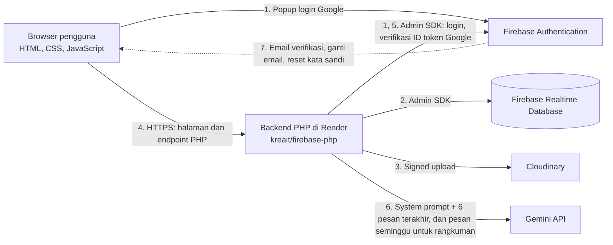
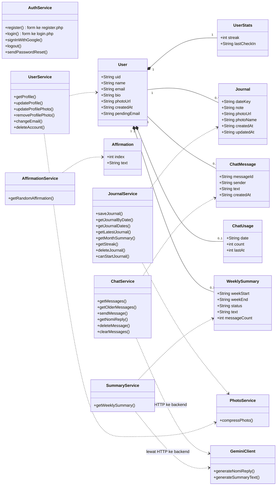

# Senara: Rancangan Teknis

Dokumen ini menjelaskan **bagaimana** Senara dibangun: arsitektur, struktur data, daftar lengkap operasi CRUD, dan keputusan teknis. Apa yang dibangun dan untuk siapa ada di [PRD](prd/Senara_PRD.md). Penjelasan per file ada di [struktur-file.md](struktur-file.md).

| | |
|---|---|
| **Produk** | Senara, website refleksi diri (afirmasi, jurnal, chat dengan Nomi) |
| **Tim** | 2 orang |
| **Deadline** | 20 Oktober 2026 |

## Daftar Isi

1. [Ringkasan Teknologi](#1-ringkasan-teknologi)
2. [Arsitektur Sistem](#2-arsitektur-sistem)
3. [Alasan Memilih Arsitektur Ini](#3-alasan-memilih-arsitektur-ini)
4. [Class Diagram](#4-class-diagram)
5. [Struktur Database](#5-struktur-database-realtime-database)
6. [Daftar Lengkap Operasi CRUD](#6-daftar-lengkap-operasi-crud)
7. [Penyimpanan Foto (Cloudinary)](#7-penyimpanan-foto-cloudinary)
8. [Detail Teknis per Fitur](#8-detail-teknis-per-fitur)
9. [Optimasi Database](#9-optimasi-database)
10. [Batas Token Gemini](#10-batas-token-gemini)
11. [Keamanan dan Security Rules](#11-keamanan-dan-security-rules)
12. [Keputusan Teknis dan Checklist](#12-keputusan-teknis-dan-checklist)
13. [Catatan UI](#13-catatan-ui)

---

## 1. Ringkasan Teknologi

| Komponen | Teknologi | Catatan |
|---|---|---|
| Frontend | HTML, CSS, JavaScript (ES modules), tanpa framework | Halaman di `public/` (landing) dan `public/views/` (lainnya) |
| Backend | PHP 8.3 + [kreait/firebase-php](https://github.com/kreait/firebase-php) (Firebase Admin SDK) | Endpoint di `public/actions/`, logika bersama di `src/` |
| Autentikasi | Firebase Authentication | Email dan kata sandi, Login with Google |
| Web Mailer | Firebase Authentication | Email verifikasi, ganti email, reset kata sandi |
| Database | Firebase Realtime Database | Hanya diakses backend lewat Admin SDK |
| Penyimpanan foto | Cloudinary (paket gratis) | Signed upload dari backend |
| Chatbot AI | Google Gemini API | Model bawaan `gemini-3.5-flash-lite` |
| Hosting | Docker (PHP + Apache) di Render (paket gratis) | Frontend dan backend satu origin |

---

## 2. Arsitektur Sistem

### 2.1 Diagram Arsitektur

Senara memakai arsitektur klien dengan Firebase sebagai Backend-as-a-Service, ditambah satu backend PHP tipis di Render. Browser tidak mengakses Realtime Database secara langsung; semua data lewat backend. Angka pada panah menunjuk ke tabel alur data di bawah diagram.



*Gambar 1. Diagram arsitektur Senara*

### 2.2 Alur Data

| No | Alur | Penjelasan |
|---|---|---|
| 1 | Login dan registrasi | Registrasi dan login email dikirim lewat form HTML ke backend PHP, yang memanggil Firebase Authentication lewat Admin SDK. Login Google dilakukan frontend lewat Firebase SDK, lalu ID token dikirim ke backend untuk diverifikasi. Setelah berhasil, backend menyimpan uid di session. |
| 2 | Baca dan tulis data | Frontend memanggil endpoint PHP; backend membaca dan menulis Realtime Database lewat Admin SDK, hanya pada path milik uid yang sedang login. Security Rules menolak semua akses langsung dari browser (Bagian 11). |
| 3 | Upload foto | Foto dikompres di browser, lalu dikirim ke backend yang mengunggahnya ke Cloudinary. URL hasil upload disimpan di field `photoUrl`. |
| 4 | Panggilan ke backend | Semua akses data, chat Nomi, dan pengiriman email lewat endpoint PHP di Render (HTTPS). |
| 5 | Verifikasi login | Setiap endpoint data dan chat mengambil uid dari session PHP (`requireLoginUid`) dan menolak permintaan tanpa session dengan 401. ID token Google diverifikasi dengan `verifyIdToken` saat login Google dan saat konfirmasi hapus akun Google. |
| 6 | Gemini | Backend mengirim system prompt dan pesan ke Gemini API untuk balasan Nomi dan rangkuman mingguan, lalu meneruskan hasilnya ke frontend. |
| 7 | Web Mailer | Email dikirim oleh server Firebase Authentication. Detail alurnya ada di Bagian 8.1. |

### 2.3 Komponen

| Komponen | Peran | Teknologi |
|---|---|---|
| Frontend Web | Landing page, ruang utama 5 menu, kompres foto sebelum upload | HTML, CSS, JavaScript; Firebase SDK hanya untuk popup login Google |
| Firebase Authentication | Registrasi, login email dan kata sandi, login Google, email verifikasi, ganti email, reset kata sandi | Firebase Auth |
| Realtime Database | Profil, jurnal, penanda tanggal, afirmasi, riwayat chat, kuota Nomi, rangkuman mingguan | Firebase Realtime Database |
| Penyimpanan Foto | Foto jurnal dan foto profil yang sudah dikompres | Cloudinary |
| Backend | Endpoint auth, data, dan chat; session login; verifikasi ID token Google; menyimpan rahasia (service account Firebase, API key Gemini, API secret Cloudinary) | PHP + kreait/firebase-php di Render |
| Gemini API | Balasan Nomi dan rangkuman mingguan | Google Gemini API |

Render juga menyajikan file frontend (static), jadi seluruh aplikasi cukup di-deploy dari satu tempat.

---

## 3. Alasan Memilih Arsitektur Ini

### 3.1 Alasan

- **Sesuai persyaratan proyek.** Firebase Auth, Realtime Database, dan Web Mailer terpakai langsung tanpa komponen tambahan.
- **Cepat dikerjakan oleh dua orang.** Autentikasi dan database dikelola Firebase, foto dikelola Cloudinary, sehingga tim tidak perlu membangun server database sendiri.
- **Rahasia tetap di server.** Service account Firebase, API key Gemini, dan API secret Cloudinary tidak boleh ada di browser; kalau ada, semuanya bisa dilihat lewat kode atau tab jaringan.
- **Keamanan berlapis.** Security Rules menolak akses langsung dari browser, dan backend hanya mengakses data milik uid yang sedang login. Endpoint data dan chat hanya melayani pengguna yang punya session, sehingga kuota Gemini tidak terkuras pihak luar.
- **Biaya rendah.** Semua layanan punya free tier. Batasnya bisa berubah, jadi cek halaman harga terbaru sebelum rilis.

### 3.2 Alternatif yang Dipertimbangkan

| Alternatif | Kelebihan | Alasan tidak dipilih |
|---|---|---|
| Semua langsung dari frontend, tanpa backend | Paling sederhana | API key Gemini terekspos, dan akses database hanya dilindungi Security Rules. |
| Backend penuh dengan database sendiri (misalnya MySQL) | Kontrol penuh atas data | Harus membangun autentikasi, upload file, dan hosting database sendiri. Bertentangan dengan persyaratan Firebase. |
| Firebase Cloud Functions sebagai backend | Terintegrasi dengan Firebase | Tim memilih Render. Cloud Functions umumnya membutuhkan paket berbayar. |
| Firebase Storage untuk foto | Satu ekosistem dengan Firebase | Project Firebase baru wajib paket Blaze (kartu kredit) untuk Storage. Cloudinary punya paket gratis. |

### 3.3 Konsekuensi

- Firebase hanya dipakai sebagai layanan backend (Auth dan Realtime Database), bukan hosting. Karena frontend dan backend satu origin, tidak perlu pengaturan CORS.
- Realtime Database tidak mendukung join dan query kompleks, jadi struktur datanya dirancang khusus (Bagian 5) dan dioptimasi (Bagian 9).
- Render paket gratis bisa "tidur" saat lama tidak dipakai, sehingga permintaan pertama terasa lambat beberapa detik di halaman mana pun.
- Semua email dikirim server Firebase, jadi tidak perlu layanan email tambahan dan pembatasan port SMTP di Render tidak berpengaruh.

---

## 4. Class Diagram

Kelas dibagi menjadi model (data), layanan (logika), dan pendukung. Layanan di browser (`public/js/services`) memanggil endpoint PHP; logika backend bersama ada di `src/`. Panah putus-putus menunjukkan dependency.



*Gambar 2. Class diagram Senara*

### 4.1 Kelas Model

| Kelas | Peran | Keterangan penting |
|---|---|---|
| User | Data akun dan profil | uid dari Firebase Auth menjadi kunci utama. name, bio, dan photoUrl bisa diubah; email bisa diganti lewat verifikasi ulang (khusus akun email dan kata sandi); createdAt hanya dibaca. |
| UserStats | Ringkasan aktivitas | streak dan tanggal jurnal terakhir (lastCheckIn), disimpan agar tidak dihitung ulang dari semua jurnal. |
| Journal | Satu momen | dateKey (yyyy-mm-dd) menjadi kunci, satu jurnal per tanggal. photoUrl dari Cloudinary. |
| ChatMessage | Satu pesan dengan Nomi | sender bernilai `user` atau `nomi`. |
| ChatUsage | Kuota harian balasan Nomi | Tanggal (WIB), jumlah balasan hari itu, dan waktu balasan terakhir. |
| WeeklySummary | Rangkuman mingguan | Satu node per pengguna, ditimpa setiap minggu. |
| Affirmation | Satu kalimat afirmasi | index 1 sampai 365 menjadi kunci. |

### 4.2 Kelas Layanan dan Pendukung

| Kelas | Tanggung jawab | Berjalan di |
|---|---|---|
| AuthService | Registrasi dan login email lewat form HTML ke `register.php` dan `login.php`; login Google (`googleAuth.js`); logout dan reset kata sandi (`authService.js`) | Frontend + backend |
| UserService | Membaca dan memperbarui profil, ganti dan hapus foto profil, ganti email, hapus akun | Frontend → backend |
| JournalService | Create, Read, Update, Delete jurnal, streak, ringkasan bulan, dan batas tanggal jurnal baru | Frontend → backend |
| PhotoService | Mengompres foto di browser sebelum dikirim | Frontend |
| AffirmationService | Mengambil satu afirmasi acak yang berbeda dari yang terakhir tampil | Frontend → backend |
| ChatService | Mengirim pesan, meminta balasan Nomi, membaca dan menghapus riwayat | Frontend → backend |
| SummaryService | Mengambil rangkuman mingguan | Frontend → backend |
| GeminiClient | Memanggil Gemini API (`callGemini` di `src/gemini.php`) untuk balasan Nomi dan rangkuman | Backend |

### 4.3 Relasi Antar Kelas

- **User dan Journal (1 ke banyak):** satu pengguna memiliki banyak jurnal, masing-masing untuk tanggal berbeda.
- **User dan ChatMessage (1 ke banyak):** satu pengguna memiliki banyak pesan chat.
- **User dengan UserStats, ChatUsage, dan WeeklySummary (composition):** ikut hilang saat akun dihapus.
- **JournalService memakai PhotoService:** foto dikompres dulu, baru diunggah backend. JournalService juga memperbarui UserStats setiap kali jurnal dibuat atau dihapus (Bagian 9.4).
- **ChatService dan SummaryService memakai GeminiClient:** lewat HTTP ke backend, karena GeminiClient berjalan di server.

---

## 5. Struktur Database (Realtime Database)

Seluruh baca dan tulis dilakukan backend PHP lewat Admin SDK; browser tidak mengakses database secara langsung.

```
users
  {uid}
    name, email, bio, photoUrl, createdAt
    pendingEmail                   hanya ada selama ganti email menunggu verifikasi
    stats
      streak, lastCheckIn
journals
  {uid}
    {dateKey}                      contoh: 2026-09-29
      note, photoUrl, photoName, createdAt, updatedAt
journalDates
  {uid}
    {dateKey}: true
affirmations
  1: "teks afirmasi ke-1"
  ...
  365: "teks afirmasi ke-365"
chats
  {uid}
    {messageId}                    kunci dari push(), otomatis urut waktu
      sender, text, createdAt
chatUsage
  {uid}
    date, count, lastAt            kuota balasan Nomi hari ini (WIB)
summaries
  {uid}
    weekStart, weekEnd             minggu yang dirangkum (Minggu dan Sabtu, WIB)
    status                         "ready" atau "not_enough"
    text, messageCount, generatedAt
    retryAfter                     hanya ada setelah Gemini gagal
```

| Path | Isi | Kapan dibaca |
|---|---|---|
| `users/{uid}` | Profil dan statistik ringkas | Setiap halaman setelah login (sidebar) dan halaman Profil |
| `journals/{uid}/{dateKey}` | Isi lengkap jurnal pada tanggal itu | Saat membuka tanggal di Journaling atau Arsip |
| `journalDates/{uid}/{dateKey}` | Penanda tanggal yang punya jurnal | Kalender Arsip, ringkasan bulan, dan streak |
| `affirmations/{1..365}` | Kalimat afirmasi | Satu node acak setiap halaman dimuat |
| `chats/{uid}/{messageId}` | Riwayat percakapan dengan Nomi | Membuka chat, menggulir ke atas, konteks Nomi, dan bahan rangkuman |
| `chatUsage/{uid}` | Kuota harian balasan Nomi | Setiap kali Nomi diminta membalas |
| `summaries/{uid}` | Rangkuman mingguan terakhir | Membuka dashboard |

Nama field disamakan dengan data yang dipakai frontend, sehingga data dari endpoint bisa langsung ditampilkan. Beberapa aturan berlaku untuk semua node:

- **dateKey** adalah tanggal berformat `yyyy-mm-dd`, misalnya `2026-10-19`. Tanggal "hari ini" selalu dihitung dalam WIB.
- **createdAt, updatedAt, generatedAt** adalah waktu ISO 8601 dalam UTC, misalnya `"2026-10-02T08:30:00Z"`.
- **lastAt, retryAfter** adalah Unix timestamp (detik).
- Realtime Database tidak menyimpan nilai `null`. Field opsional yang kosong, seperti `photoUrl` tanpa foto, tidak muncul di node sama sekali.

### 5.1 users

Profil setiap pengguna beserta statistik jurnal ringkas. Dibuat otomatis saat registrasi atau login Google pertama, lalu dibaca di setiap halaman setelah login untuk sidebar dan halaman Profil.

Setiap pengguna punya satu node `users/{uid}`:

| Field | Isi |
|---|---|
| `name` | Nama tampilan, wajib diisi, maks. 40 karakter. Saat login Google diambil dari nama akun Google; jika kosong, diambil dari bagian depan email. |
| `email` | Salinan email dari Firebase Auth. Email di Auth tetap sumber utama; salinan ini disamakan lagi setelah ganti email. |
| `bio` | Bio singkat, boleh kosong, maks. 160 karakter. |
| `photoUrl` | URL foto profil di Cloudinary (`senara/avatars/{uid}`), atau URL foto Google untuk akun Google sampai diganti atau dihapus. Tidak ada jika tanpa foto. |
| `createdAt` | Waktu akun dibuat. |
| `pendingEmail` | Opsional. Email baru yang link verifikasinya belum diklik. Dihapus otomatis setelah email di Auth berubah. |
| `stats.streak` | Jumlah hari berturut-turut yang punya jurnal. |
| `stats.lastCheckIn` | dateKey jurnal terbaru. Tidak ada jika belum pernah menulis jurnal. |

`stats` hanya diperbarui saat jurnal disimpan atau dihapus. Karena streak bisa putus seiring berjalannya hari, dashboard menghitung ulang streak dari `journalDates` lewat `streak.php`, bukan membaca `stats.streak`.

### 5.2 journals

Isi lengkap jurnal harian. Satu pengguna hanya punya satu jurnal per tanggal, jadi dateKey langsung dipakai sebagai kunci tanpa journalId.

Setiap jurnal tersimpan di `journals/{uid}/{dateKey}`:

| Field | Isi |
|---|---|
| `note` | Catatan jurnal, maks. 2000 karakter. Boleh kosong jika ada foto; minimal salah satu dari catatan atau foto harus diisi. |
| `photoUrl` | URL foto jurnal di Cloudinary (`senara/journals/{uid}/{dateKey}`). Tidak ada jika tanpa foto. |
| `photoName` | Nama file asli foto (maks. 120 karakter), ditampilkan di form edit. Tidak ada jika tanpa foto. |
| `createdAt` | Waktu jurnal pertama kali dibuat. Tidak berubah saat jurnal disunting. |
| `updatedAt` | Waktu jurnal terakhir disimpan. |

Jurnal baru hanya bisa dibuat untuk hari ini sampai 2 hari sebelumnya (`JOURNAL_BACKDATE_DAYS`), agar streak tidak bisa diisi mundur. Jurnal lama yang sudah ada tetap bisa disunting.

### 5.3 journalDates

Penanda tanggal yang punya jurnal. Node ini sengaja dipisah dari `journals` agar kalender Arsip, ringkasan bulan, dan streak cukup membaca daftar tanggal tanpa ikut mengunduh isi jurnal.

Setiap tanggal tersimpan di `journalDates/{uid}/{dateKey}`:

| Kunci / nilai | Isi |
|---|---|
| `{dateKey}` | Tanggal yang punya jurnal. |
| nilai | Selalu `true`. |

`journals` dan `journalDates` selalu ditulis dan dihapus bersamaan dalam satu multi-path update, sehingga keduanya tidak pernah berbeda.

### 5.4 affirmations

Kumpulan 365 kalimat afirmasi harian. Node ini diisi sekali di awal dengan import file JSON lewat Firebase Console, lalu hanya dibaca oleh website dan tidak pernah ditulis. Tidak memerlukan login karena afirmasi juga tampil di landing page.

| Kunci / nilai | Isi |
|---|---|
| `1` sampai `365` | Nomor afirmasi. |
| nilai | Teks afirmasi (String). |

Setiap kali halaman dimuat, hanya satu nomor acak yang dibaca, bukan seluruh 365 kalimat. Nomor yang terakhir tampil dilewati agar afirmasi tidak muncul dua kali berturut-turut.

### 5.5 chats

Riwayat percakapan dengan Nomi. Pesan pengguna dan balasan Nomi disimpan di tempat yang sama dan dibedakan lewat `sender`.

Setiap pesan tersimpan di `chats/{uid}/{messageId}`:

| Field | Isi |
|---|---|
| `{messageId}` | Kunci dari `push()`. 8 karakter pertamanya berisi waktu pembuatan, jadi pesan otomatis urut waktu dan bisa diambil per rentang waktu tanpa index tambahan. |
| `sender` | `"user"` untuk pesan pengguna, `"nomi"` untuk balasan Nomi. |
| `text` | Isi pesan. Pesan pengguna maks. 1000 karakter; panjang balasan Nomi dibatasi `maxOutputTokens` 256. |
| `createdAt` | Waktu pesan dikirim. |

Halaman chat memuat pesan 3 hari terakhir (minimal 20 pesan), lalu 30 pesan lebih lama setiap kali pengguna menggulir ke atas. Pengguna bisa menghapus satu pesan atau membersihkan seluruh riwayat; saat riwayat dibersihkan, `summaries/{uid}` ikut dihapus agar isi chat tidak tersisa di dashboard.

### 5.6 chatUsage

Catatan pemakaian chat Nomi per pengguna. Gunanya membatasi seberapa sering Gemini dipanggil, supaya kuota API tidak cepat habis dan tidak disalahgunakan, misalnya kena spam.

Setiap pengguna punya satu node `chatUsage/{uid}` dengan 3 field:

| Field | Isi |
|---|---|
| `date` | Tanggal hari ini (WIB), misalnya `2026-10-19`. |
| `count` | Jumlah balasan Nomi yang sudah diminta pada tanggal itu. |
| `lastAt` | Waktu (Unix timestamp) balasan terakhir diminta. |

Setiap kali pengguna meminta balasan Nomi, `claimNomiReplyQuota()` di `src/chat.php` memeriksa node ini:

1. Jika belum lewat 3 detik sejak `lastAt` (`NOMI_REPLY_COOLDOWN`), permintaan ditolak.
2. Jika `count` sudah 100 (`NOMI_DAILY_LIMIT`), permintaan ditolak sampai besok.
3. Jika `date` bukan hari ini, `count` dianggap 0, jadi kuota direset otomatis tanpa job terjadwal.
4. Jika lolos, `count` bertambah 1 dan `lastAt` diisi waktu sekarang, baru Gemini dipanggil.

Kuota disimpan per uid, bukan di session, agar tidak bisa dilewati dengan login ulang. Node ini juga tidak ikut terhapus saat riwayat chat dibersihkan, dan baru hilang saat akun dihapus.

### 5.7 summaries

Rangkuman mingguan chat dengan Nomi yang tampil di dashboard. Yang dirangkum adalah minggu lalu (Minggu sampai Sabtu, WIB); rangkuman mulai tampil hari Senin dan tidak berubah sampai Senin berikutnya. Setiap pengguna hanya punya satu node yang ditimpa setiap minggu, sehingga Gemini dipanggil paling banyak sekali per pengguna per minggu.

Setiap pengguna punya satu node `summaries/{uid}`:

| Field | Isi |
|---|---|
| `weekStart` | dateKey hari Minggu dari minggu yang dirangkum. |
| `weekEnd` | dateKey hari Sabtu dari minggu yang dirangkum. |
| `status` | `"ready"` jika rangkuman dibuat, `"not_enough"` jika pesan pengguna minggu itu kurang dari 5. |
| `text` | Rangkuman 2–3 kalimat (maks. 50 kata) dari Gemini. Tidak ada jika `"not_enough"`. |
| `messageCount` | Jumlah pesan pengguna yang dipakai sebagai bahan rangkuman. Pesan yang sangat pendek (di bawah 10 karakter) tidak dihitung. |
| `generatedAt` | Waktu rangkuman dibuat. |
| `retryAfter` | Opsional. Hanya ada setelah Gemini gagal; Gemini tidak dipanggil lagi sebelum waktu ini (jeda 1 jam). |

Saat rangkuman minggu baru berhasil dibuat, seluruh node ditimpa dengan `set()`, sehingga `retryAfter` dari kegagalan sebelumnya ikut hilang. Jika Gemini gagal dan masih ada rangkuman minggu sebelumnya, rangkuman lama itu yang ditampilkan dengan tanda "belum diperbarui".

---

## 6. Daftar Lengkap Operasi CRUD

Persyaratan tugas meminta minimal 12 fungsi CRUD (3 Create, 3 Read, 3 Update, 3 Delete) yang terhubung ke Firebase Realtime Database. Senara menjalankan lebih banyak dari itu. Bagian 6.1 adalah 12 fungsi utama untuk memenuhi syarat, dan Bagian 6.2 adalah seluruh operasi yang benar-benar berjalan di website.

### 6.1 Fungsi CRUD Utama (Syarat Minimum)

| No | Fungsi dan fitur | Path (Realtime Database) | Di daftar lengkap |
|---|---|---|---|
| Create 1 | Registrasi: membuat profil pengguna | `users/{uid}` | C1 |
| Create 2 | Journaling: menyimpan jurnal baru | `journals/{uid}/{dateKey}`, `journalDates/{uid}/{dateKey}` | C3 |
| Create 3 | Chat Nomi: menyimpan pesan pengguna dan balasan Nomi | `chats/{uid}/{messageId}` | C5, C6 |
| Read 1 | Arsip: membuka jurnal pada tanggal terpilih | `journals/{uid}/{dateKey}` | R4 |
| Read 2 | Arsip: kalender bulanan | `journalDates/{uid}` per bulan | R6 |
| Read 3 | Profil: data diri dan statistik | `users/{uid}`, `journalDates/{uid}` | R1, R2 |
| Update 1 | Edit jurnal (catatan, foto) | `journals/{uid}/{dateKey}` | U1, U2 |
| Update 2 | Simpan perubahan profil (nama, bio) | `users/{uid}` | U4 |
| Update 3 | Ganti foto profil | `users/{uid}/photoUrl` | U5 |
| Delete 1 | Hapus jurnal beserta fotonya | `journals`, `journalDates`, `users/{uid}/stats` | D1 |
| Delete 2 | Hapus satu pesan atau bersihkan riwayat chat | `chats/{uid}`, `summaries/{uid}` | D2, D3 |
| Delete 3 | Hapus akun beserta seluruh datanya | Semua node milik uid | D5 |

### 6.2 Daftar Lengkap

Totalnya **34 operasi: 7 Create, 11 Read, 11 Update, 5 Delete**. Kolom "Utama" menunjukkan operasi yang termasuk 12 fungsi di Bagian 6.1. Operasi yang menyentuh Cloudinary ikut dicatat karena berjalan bersama data di Realtime Database.

**Create**

| No | Operasi | Path / tempat | Endpoint | Fungsi frontend | Utama |
|---|---|---|---|---|---|
| C1 | Registrasi email: membuat profil (nama, email, bio kosong, createdAt, stats awal) | `users/{uid}` | `register.php` | form registrasi | Create 1 |
| C2 | Login Google pertama kali: membuat profil dengan nama dan foto Google | `users/{uid}` | `google_login.php` | `signInWithGoogle` | - |
| C3 | Menyimpan jurnal baru (hanya untuk hari ini sampai 2 hari sebelumnya) | `journals/{uid}/{dateKey}`, `journalDates/{uid}/{dateKey}` | `journals.php` POST | `saveJournal` | Create 2 |
| C4 | Mengunggah foto jurnal baru | Cloudinary `senara/journals/{uid}/{dateKey}`, lalu `photoUrl` | `journals.php` POST | `saveJournal` | - |
| C5 | Menyimpan pesan pengguna | `chats/{uid}/{messageId}` | `chat.php` POST | `sendMessage` | Create 3 |
| C6 | Menyimpan balasan Nomi dari Gemini | `chats/{uid}/{messageId}` | `nomi_reply.php` | `getNomiReply` | Create 3 |
| C7 | Membuat rangkuman mingguan pertama kali | `summaries/{uid}` | `weekly_summary.php` | `getWeeklySummary` | - |

**Read**

| No | Operasi | Path / tempat | Endpoint | Fungsi frontend | Utama |
|---|---|---|---|---|---|
| R1 | Profil: nama dan avatar di sidebar setiap halaman, data diri di halaman Profil (sekali per halaman) | `users/{uid}` + akun Firebase Auth | `profile.php` GET | `getProfile` | Read 3 |
| R2 | Streak dan status 7 hari minggu ini (Dashboard, Profil) | `journalDates/{uid}` | `streak.php` | `getStreak` | Read 3 |
| R3 | Afirmasi acak (landing page, Dashboard) | `affirmations/{n}` | `affirmation.php` | `getRandomAffirmation` | - |
| R4 | Jurnal pada satu tanggal (Journaling, panel detail Arsip) | `journals/{uid}/{dateKey}` | `journals.php?date=` | `getJournalByDate` | Read 1 |
| R5 | Jurnal terakhir untuk mode Edit | `journals/{uid}`, `limitToLast(1)` | `journals.php?latest=1` | `getLatestJournal` | - |
| R6 | Tanggal yang punya jurnal dalam satu bulan (kalender Arsip; ringkasan bulan dihitung dari data yang sama) | `journalDates/{uid}`, rentang kunci per bulan | `journals.php?month=` | `getJournalDates`, `getMonthSummary` | Read 2 |
| R7 | Riwayat chat saat halaman dibuka (3 hari terakhir, minimal 20 pesan) | `chats/{uid}`, `startAt` + `limitToLast` | `chat.php` GET | `getMessages` | - |
| R8 | 30 pesan lama saat menggulir ke atas | `chats/{uid}`, `endAt` + `limitToLast(31)` | `chat.php?before=` | `getOlderMessages` | - |
| R9 | Konteks balasan Nomi: 6 pesan terakhir dan nama pengguna | `chats/{uid}`, `users/{uid}/name` | `nomi_reply.php` | `getNomiReply` | - |
| R10 | Rangkuman mingguan yang tersimpan | `summaries/{uid}` | `weekly_summary.php` | `getWeeklySummary` | - |
| R11 | Pesan pengguna seminggu sebagai bahan rangkuman (hanya saat rangkuman dibuat) | `chats/{uid}`, rentang Minggu–Sabtu | `weekly_summary.php` | `getWeeklySummary` | - |

**Update**

| No | Operasi | Path / tempat | Endpoint | Fungsi frontend | Utama |
|---|---|---|---|---|---|
| U1 | Edit catatan jurnal | `journals/{uid}/{dateKey}`: `note`, `updatedAt` | `journals.php` POST | `saveJournal` | Update 1 |
| U2 | Ganti foto jurnal (foto lama ditimpa di lokasi yang sama) | Cloudinary, `journals/{uid}/{dateKey}`: `photoUrl`, `photoName` | `journals.php` POST | `saveJournal` | Update 1 |
| U3 | Hapus foto dari jurnal tanpa menghapus jurnalnya | `photoUrl` dikosongkan, foto dihapus dari Cloudinary | `journals.php` POST (`removePhoto`) | `saveJournal` | - |
| U4 | Simpan nama lengkap dan bio | `users/{uid}`: `name`, `bio` | `profile.php` POST | `updateProfile` | Update 2 |
| U5 | Unggah atau ganti foto profil (dipotong 400 × 400 px) | Cloudinary `senara/avatars/{uid}`, `users/{uid}/photoUrl` | `profile_photo.php` POST | `updateProfilePhoto` | Update 3 |
| U6 | Hitung ulang streak setelah jurnal dibuat, diedit, atau dihapus | `users/{uid}/stats`: `streak`, `lastCheckIn` | `journals.php` | (otomatis) | - |
| U7 | Minta ganti email: catat email baru yang menunggu verifikasi | `users/{uid}/pendingEmail` | `change_email.php` | `changeEmail` | - |
| U8 | Sinkron email setelah link ganti email diklik | `users/{uid}`: `email`, hapus `pendingEmail` | `profile.php` GET | `getProfile` | - |
| U9 | Catat pemakaian Nomi (jumlah balasan hari ini dan waktu terakhir) | `chatUsage/{uid}` | `nomi_reply.php` | `getNomiReply` | - |
| U10 | Ganti rangkuman dengan rangkuman minggu baru (setiap Senin) | `summaries/{uid}` | `weekly_summary.php` | `getWeeklySummary` | - |
| U11 | Tandai jeda 1 jam setelah Gemini gagal membuat rangkuman | `summaries/{uid}/retryAfter` | `weekly_summary.php` | `getWeeklySummary` | - |

**Delete**

| No | Operasi | Path / tempat | Endpoint | Fungsi frontend | Utama |
|---|---|---|---|---|---|
| D1 | Hapus jurnal beserta fotonya, lalu hitung ulang streak (U6) | `journals/{uid}/{dateKey}`, `journalDates/{uid}/{dateKey}`, Cloudinary | `journals.php` DELETE | `deleteJournal` | Delete 1 |
| D2 | Hapus satu pesan chat | `chats/{uid}/{messageId}` | `chat.php?id=` DELETE | `deleteMessage` | Delete 2 |
| D3 | Bersihkan seluruh riwayat chat beserta rangkumannya | `chats/{uid}`, `summaries/{uid}` | `chat.php?all=1` DELETE | `clearMessages` | Delete 2 |
| D4 | Hapus foto profil (avatar kembali ke inisial) | `users/{uid}/photoUrl`, Cloudinary | `profile_photo.php` DELETE | `removeProfilePhoto` | - |
| D5 | Hapus akun beserta seluruh datanya | `users`, `journals`, `journalDates`, `chats`, `chatUsage`, `summaries` milik uid, semua foto di Cloudinary, lalu akun Firebase Auth | `delete_account.php` | `deleteAccount` | Delete 3 |

### 6.3 Operasi yang Tidak Dihitung sebagai CRUD Database

**Firebase Authentication** (bukan Realtime Database):

- Membuat akun (registrasi), dan menghapusnya lagi bila profil gagal dibuat agar tidak ada akun tanpa profil.
- Login email, login Google (verifikasi ID token), logout.
- Kirim dan kirim ulang email verifikasi, email ganti email, email reset kata sandi.
- Cek kata sandi sebelum ganti email dan hapus akun, atau login Google ulang sebelum hapus akun.

**Pembacaan pendukung di backend** (bagian dari operasi di atas, bukan fitur tersendiri):

- Cek apakah profil sudah ada sebelum menyimpan jurnal, profil, atau foto profil. Jika belum ada, profil dibuat dari data Firebase Auth (sama seperti C2).
- Cek jurnal yang sudah ada sebelum menyimpan, untuk menentukan Create atau Update dan menegakkan batas 3 hari.
- Membaca semua tanggal jurnal untuk menghitung ulang streak (bagian dari U6).

**Data statis di frontend:** langkah Latihan Napas di chat Nomi.

---

## 7. Penyimpanan Foto (Cloudinary)

Kredensial Cloudinary (cloud name, API key, API secret) dibaca dari environment variable atau `cloudinary_config.php` di root project (di luar `public/`, tidak masuk git). Karena API secret tidak boleh ada di browser, unggahan selalu lewat backend.

**Alur upload:**

1. Pengguna memilih foto di Journaling atau Profil.
2. Frontend mengecilkan dan mengompres foto di browser (tabel di bawah).
3. Frontend mengirim foto ke endpoint PHP. Backend memeriksa isi file (JPG, PNG, atau WebP) dan ukurannya (jurnal maks. 5 MB, foto profil maks. 3 MB), lalu mengunggahnya dengan signed upload.
4. Cloudinary mengembalikan URL, misalnya `https://res.cloudinary.com/{cloud_name}/image/upload/v123/senara/journals/{uid}/2026-09-29.webp`. Nomor versi berubah setiap foto diganti, sehingga browser tidak menampilkan foto lama dari cache.
5. Backend menyimpan URL di field `photoUrl`.

**Lokasi file:**

| Foto | public_id | Keterangan |
|---|---|---|
| Foto profil | `senara/avatars/{uid}` | Dipotong 400 × 400 px oleh Cloudinary saat diunggah. |
| Foto jurnal | `senara/journals/{uid}/{dateKey}` | Satu foto per jurnal. |

Karena public_id ditentukan dari uid dan tanggal, foto baru selalu menimpa foto lama di lokasi yang sama, dan database tidak perlu menyimpan path file. Akun Cloudinary memakai mode *dynamic folders*, jadi backend mengisi `asset_folder` terpisah (`Senara-Project/avatars`, `Senara-Project/journals/{uid}`) hanya untuk kerapian Media Library. Saat akun dihapus, semua foto jurnal dihapus lewat Admin API berdasarkan prefix.

**Pengaturan kompres (frontend):**

| Parameter | Nilai | Alasan |
|---|---|---|
| Lebar maksimal | 1080 px | Detail jurnal tampil sekitar 500–600 px; layar resolusi tinggi butuh sekitar 2 kali lipat. |
| Kualitas | 0.8 | Hampir tidak terlihat beda dari aslinya. |
| Format | WebP (cadangan JPEG) | Didukung browser modern, ukurannya lebih kecil. |
| Target ukuran akhir | 200–400 KB | Foto HP sekitar 5 MB turun ke kisaran ini. |
| Batas file sebelum kompresi | 10 MB | File di atas batas ditolak. |

---

## 8. Detail Teknis per Fitur

### 8.1 Registrasi, Login, dan Web Mailer

- **Registrasi email:** form dikirim ke `register.php`, yang membuat akun di Firebase Auth, membuat profil (C1), lalu memanggil `sendEmailVerificationLink()` dengan `continueUrl` ke `views/login.html?verified=1`. Pengguna diarahkan ke halaman Cek Email. Jika profil gagal dibuat, akun Auth dihapus lagi.
- **Kirim ulang verifikasi:** dari halaman Cek Email atau banner Login, dengan jeda 60 detik (`VERIFICATION_RESEND_COOLDOWN`).
- **Login email:** `login.php` memanggil `signInWithEmailAndPassword`. Session hanya dibuat jika `emailVerified` bernilai true. Jika gagal, pengguna diarahkan kembali ke `login.html?error=<kode>`; email yang diketik disimpan sementara di `sessionStorage` agar terisi kembali.
- **Error login:** Email Enumeration Protection aktif, sehingga akun tidak ditemukan dan kata sandi salah sama-sama menjadi `INVALID_LOGIN_CREDENTIALS` dan ditampilkan sebagai "Email atau kata sandi salah". Error lain: `INVALID_EMAIL`, email belum diverifikasi, `TOO_MANY_ATTEMPTS_TRY_LATER`.
- **Login Google:** popup Firebase SDK di frontend, lalu ID token dikirim ke `google_login.php`. Hanya token dengan `sign_in_provider` `google.com` yang diterima, agar syarat verifikasi email tidak bisa dilewati. Profil dibuat saat login pertama (C2).
- **Reset kata sandi:** dikirim ke email akun yang aktif di Firebase Auth (bukan dari session), dengan `continueUrl` ke halaman Login.

### 8.2 Ganti Email

`change_email.php` mengecek kata sandi, lalu meminta Firebase mengirim link ke email baru lewat REST API Identity Toolkit (`sendOobCode` dengan `VERIFY_AND_CHANGE_EMAIL`), karena Admin SDK tidak menyediakan alur ini. Email baru dicatat di `pendingEmail` (U7). Email akun baru berganti setelah link diklik, sehingga email baru selalu terverifikasi dan salah ketik tidak membuat akun terkunci. Link membawa pengguna ke `views/profil.html?emailChanged=1`; saat profil dibaca, backend menyamakan `email` dengan Auth dan menghapus `pendingEmail` (U8). Pengiriman dibatasi sekali per 60 detik.

**Akun Google tidak bisa mengganti email**, karena (1) butuh konfirmasi kata sandi yang tidak dimiliki akun Google, (2) Gmail adalah identitas akun Google, jadi email di Senara akan berbeda dengan email yang dipakai login, dan (3) ini pola umum aplikasi dengan Login with Google. Pembatasan dua lapis: frontend hanya menampilkan ikon pena jika `hasPassword` bernilai true (dihitung dari provider akun), dan `change_email.php` menolak akun tanpa provider password.

### 8.3 Chat Nomi

- **Memuat bertahap:** `chat.php` mengirim pesan 3 hari terakhir; jika kurang dari 20, yang dikirim 20 pesan terakhir; paling banyak 200 pesan. Saat menggulir ke atas, `chat.php?before={id}` mengirim 30 pesan sebelumnya beserta `hasMore`.
- **Rentang waktu tanpa index tambahan:** 8 karakter pertama kunci `push()` adalah waktu pembuatan, jadi rentang dicari dengan `orderByKey().startAt(awalan kunci)`.
- **Konstanta** di `src/chat.php`: `CHAT_MESSAGE_MAX` (1000), `CHAT_RECENT_DAYS` (3), `CHAT_MIN_MESSAGES` (20), `CHAT_RECENT_MAX` (200), `CHAT_PAGE_SIZE` (30), `NOMI_CONTEXT_MESSAGES` (6), `NOMI_MAX_OUTPUT_TOKENS` (256), `NOMI_REPLY_COOLDOWN` (3 detik), `NOMI_DAILY_LIMIT` (100).
- **Kuota:** dicatat per uid di `chatUsage/{uid}` (U9), bukan di session, agar tidak bisa dilewati dengan login ulang dan tidak ikut terhapus saat riwayat dibersihkan.
- **Pesan dan balasan disimpan terpisah:** pesan pengguna disimpan dulu (C5), lalu balasan diminta lewat `nomi_reply.php` (C6), sehingga pesan tidak hilang walaupun Gemini gagal.
- **Kapasitas:** satu pesan sekitar 200 byte, sehingga 1 GB Realtime Database muat sekitar 5 juta pesan. Jika perlu, bisa ditambah aturan retensi (misalnya hapus pesan lebih dari 1 tahun).

### 8.4 Rangkuman Mingguan

- Yang dirangkum adalah minggu sebelumnya, Minggu sampai Sabtu (WIB). Rangkuman berganti setiap Senin dan tidak berubah sampai Senin berikutnya (`summaryWeek()` di `src/summary.php`).
- Rangkuman dibuat saat dashboard pertama kali dibuka mulai Senin, lalu disimpan di `summaries/{uid}` (C7/U10). Kartu dimuat terpisah agar afirmasi dan streak tidak ikut menunggu.
- Jika pesan pengguna minggu itu kurang dari 5, Gemini tidak dipanggil dan status `not_enough` disimpan.
- Jika Gemini gagal, rangkuman sebelumnya tetap dikirim dengan `stale = true`, dan percobaan berikutnya ditunda 1 jam lewat `retryAfter` (U11).

### 8.5 Jurnal dan Streak

- Jurnal baru hanya diterima untuk tanggal `hari ini − JOURNAL_BACKDATE_DAYS` sampai hari ini (WIB), dengan `JOURNAL_BACKDATE_DAYS = 2` di `src/journals.php` dan `public/js/config.js`. Jurnal yang sudah ada tetap bisa disunting dan dihapus.
- Tanggal di masa depan ditolak, dengan toleransi satu hari untuk zona waktu yang lebih maju dari WIB.
- Streak dihitung mundur dari hari ini; jika hari ini belum ada jurnal, hitungan dimulai dari kemarin. `streak.php` selalu menghitung ulang dari `journalDates`, karena streak bisa putus seiring berjalannya hari, sedangkan `users/{uid}/stats` hanya diperbarui saat jurnal disimpan atau dihapus.
- Status 7 hari (Minggu sampai Sabtu minggu ini) dikirim sebagai `weekDays` dengan tanda `done`, `isToday`, dan `isFuture`.

### 8.6 Hapus Foto Profil dan Hapus Akun

- **Hapus foto profil:** `profile_photo.php` (DELETE) menghapus `users/{uid}/photoUrl`, lalu foto di Cloudinary. Jika penghapusan di Cloudinary gagal, foto tetap hilang dari profil dan kegagalannya hanya dicatat di log. Foto Google tidak muncul lagi saat login berikutnya, karena foto Google hanya diambil saat profil pertama kali dibuat.
- **Hapus akun:** wajib konfirmasi kata sandi atau login Google ulang. Urutannya: hapus semua foto di Cloudinary, hapus semua node milik uid dalam satu multi-path update, lalu hapus akun Firebase Auth.

### 8.7 Afirmasi

Frontend mengirim nomor afirmasi terakhir (disimpan di `sessionStorage`). Backend memilih nomor acak 1–365 yang berbeda, lalu hanya mengambil node itu. Dataset 365 kalimat diisi sekali lewat Firebase Console atau skrip admin.

---

## 9. Optimasi Database

Realtime Database mengunduh seluruh isi node yang dibaca dan tidak punya join. Jadi optimasinya berfokus pada membaca sesedikit mungkin data pada setiap aksi.

### 9.1 Struktur datar dan dipisah per pengguna

Jurnal, profil, chat, kuota, dan rangkuman ada di node terpisah, bukan bersarang di `users`. Membaca profil tidak ikut menarik ratusan jurnal, dan pengecekan akses per uid jadi sederhana.

### 9.2 Kunci tanggal dan query per bulan

Kalender bulan Oktober cukup mengambil `journalDates/{uid}` dengan `orderByKey().startAt("2026-10-01").endAt("2026-10-31")`. Query berdasarkan kunci tidak butuh `.indexOn`, dan Firebase hanya mengirim tanggal di rentang itu.

### 9.3 Penanda kalender yang ringan

`journalDates` hanya berisi pasangan tanggal dan `true`, jauh lebih kecil dari jurnal lengkap. Isi jurnal baru dibaca saat satu tanggal diklik. Jurnal dan penandanya ditulis dengan satu multi-path update agar selalu konsisten. Di frontend, tanggal per bulan di-cache sehingga kalender dan ringkasan bulan hanya memicu satu baca.

### 9.4 Menyimpan ringkasan statistik

Streak disimpan di `users/{uid}/stats` dan diperbarui setiap kali jurnal disimpan atau dihapus, sehingga profil cukup membaca satu node kecil. Streak dihitung ulang dari `journalDates`, karena jurnal bisa ditulis sampai 2 hari mundur dan bisa dihapus.

### 9.5 Foto di Cloudinary, hanya URL di database

Database hanya menyimpan `photoUrl`. Foto dikompres dulu di frontend (Bagian 7).

### 9.6 Afirmasi: baca satu node acak

Setiap muat halaman hanya membaca satu kalimat, bukan 365, dan tidak memakai kuota Gemini.

### 9.7 Baca sekali per permintaan

Backend membaca data sekali per permintaan (`getValue` / `getSnapshot`), bukan lewat listener realtime. Balasan Nomi ditampilkan dari respons endpoint. Profil di-cache per halaman di frontend karena dipakai sidebar dan halaman Profil sekaligus.

### 9.8 Batasi jumlah data yang dibaca

Riwayat chat dimuat bertahap (Bagian 8.3), kalender membaca penanda per bulan, dan isi jurnal dibaca per tanggal.

### 9.9 Ringkasan

| Teknik | Yang dihemat |
|---|---|
| Struktur datar per pengguna | Membaca profil tidak menarik data jurnal |
| Kunci tanggal + query per bulan | Tidak mengunduh semua jurnal untuk kalender |
| journalDates | Kalender tampil tanpa membaca isi jurnal |
| Streak tersimpan | Profil tidak menghitung dari semua jurnal |
| Foto di Cloudinary + kompres | Ukuran database kecil, penyimpanan hemat |
| Afirmasi 1 node acak | Satu baca kecil per muat halaman |
| `limitToLast` dan konteks Gemini terbatas | Bandwidth dan token |
| Rangkuman disimpan per minggu | Gemini dipanggil maksimal sekali per pengguna per minggu |
| Rules tolak semua + validasi di PHP | Mencegah data sampah dan akses lintas pengguna |

---

## 10. Batas Token Gemini

Gemini dipakai di dua tempat, balasan Nomi (`src/chat.php`) dan rangkuman mingguan (`src/summary.php`). Keduanya lewat `callGemini` di `src/gemini.php`.

| Batas | Nomi (balasan chat) | Rangkuman mingguan |
|---|---|---|
| Kapan dipanggil | Setiap pesan pengguna; maks. 100 balasan per hari dan jeda 3 detik per pengguna | Maks. sekali per pengguna per minggu, hanya jika ada minimal 5 pesan |
| System prompt | ±2.600 karakter (±650 token), termasuk aturan gaya bicara dan contoh | ±500 karakter (±125 token) |
| Isi input | 6 pesan terakhir (pesan pengguna dan balasan Nomi) | Hanya pesan pengguna minggu lalu; pesan di bawah 10 karakter dilewati |
| Batas per pesan | Pesan pengguna maks. 1.000 karakter (ditolak jika lebih) | Setiap pesan dipotong menjadi 300 karakter |
| Batas total input | 6 pesan | Maks. 6.000 karakter; jika lebih, pesan terbaru yang diambil |
| Perkiraan input maksimal | ±2.150 token (biasanya ±800 token karena pesan chat pendek) | ±1.650 token |
| Batas output | `maxOutputTokens` 256 | `maxOutputTokens` 300 |
| Perkiraan output biasa | ±30–100 token (1–4 kalimat, mengikuti panjang pesan pengguna) | ±100 token (JSON 2–3 kalimat) |
| Format output | Teks biasa | JSON (`responseMimeType` + `responseSchema`) |
| Temperature | 0.8 | 0.5 |
| Konstanta | `CHAT_MESSAGE_MAX`, `NOMI_CONTEXT_MESSAGES`, `NOMI_MAX_OUTPUT_TOKENS` | `SUMMARY_MIN_CHARS`, `SUMMARY_MESSAGE_MAX_CHARS`, `SUMMARY_INPUT_MAX_CHARS`, `SUMMARY_MAX_OUTPUT_TOKENS` |

**Thinking.** Token thinking ikut dihitung ke batas output, jadi diatur serendah mungkin oleh `geminiThinkingConfig`:

| Model | Pengaturan thinking |
|---|---|
| Gemini 2.5 Flash dan 2.5 Flash-Lite | `thinkingBudget` 0 |
| Model "lite" generasi 3 ke atas (misalnya `gemini-3.5-flash-lite`, bawaan) | Tidak dikirim; bawaannya sudah minimal |
| Model generasi 3 ke atas lainnya | `thinkingLevel` "low" |

`thinkingBudget` dan `thinkingLevel` tidak boleh dikirim bersamaan (Gemini menolak dengan error 400). Angka token adalah perkiraan dengan asumsi sekitar 4 karakter per token; jumlah sebenarnya ada di `usageMetadata` respons Gemini.

---

## 11. Keamanan dan Security Rules

Backend memakai service account (Admin SDK), sehingga tidak terkena Security Rules. Karena browser tidak pernah mengakses database langsung, rules menolak semua akses klien:

```json
{
  "rules": {
    ".read": false,
    ".write": false
  }
}
```

Pembatasan per pengguna dan validasi dilakukan di backend:

- **Akses per uid:** setiap endpoint mengambil uid dari session login, bukan dari input browser.
- **Validasi data:** dateKey berformat yyyy-mm-dd dan tanggalnya valid, batas 3 hari untuk jurnal baru, note maks. 2000 karakter, nama maks. 40 dan bio maks. 160 karakter, pesan chat maks. 1000 karakter, id pesan harus berformat kunci `push()`, jenis dan ukuran foto diperiksa dari isi file.
- **Rahasia di luar `public/`:** `firebase_credentials.json`, `cloudinary_config.php`, `gemini_config.php`, dan `firebase_web_config.php` ada di root project dan tidak masuk git; di Render diisi lewat environment variable.
- **Konfirmasi aksi sensitif:** ganti email dan hapus akun meminta kata sandi atau login Google ulang.
- **Header keamanan** (diatur di `Dockerfile`): `X-Frame-Options: DENY`, `X-Content-Type-Options: nosniff`, `Referrer-Policy`, dan `Content-Security-Policy` (`frame-ancestors 'none'`).

**Free tier.** Realtime Database punya batas penyimpanan, unduhan bulanan, dan koneksi bersamaan. Pantau penggunaan di Firebase Console.

---

## 12. Keputusan Teknis dan Checklist

### 12.1 Keputusan yang Ditetapkan

- Deploy tunggal di Render; Firebase hanya untuk Auth dan Realtime Database.
- Foto di Cloudinary karena Firebase Storage pada project baru wajib paket Blaze.
- Login email diblokir sampai email terverifikasi; login Google dianggap terverifikasi.
- Satu jurnal per tanggal; kunci database berupa dateKey yyyy-mm-dd.
- Afirmasi 365 kalimat diisi sekali, dibaca satu node acak, tidak disimpan per pengguna.
- Email Enumeration Protection aktif.
- Semua alamat halaman, endpoint, dan aset di frontend dihitung dari lokasi `public/js/config.js`, karena halaman ada di dua tingkat folder (`public/` dan `public/views/`).

### 12.2 Checklist Sebelum Rilis

- Email Enumeration Protection aktif di Firebase Console.
- Domain deploy dan `localhost` terdaftar di Authorized domains.
- Node `affirmations` sudah berisi 365 kalimat.
- Batas free tier Gemini, Realtime Database, dan Cloudinary sudah dicek.
- Environment variable di Render sudah lengkap.

---

## 13. Catatan UI

### 13.1 Font

Font teks didefinisikan sebagai variabel di `public/css/variables.css` dan dimuat lewat Google Fonts.

| Font | Variabel | Dipakai untuk |
|---|---|---|
| Bricolage Grotesque | `--font-display` | Judul, nama brand di sidebar |
| Nunito Sans | `--font-body` | Teks biasa, tombol, label menu, form |
| Fraunces (serif) | `--font-serif` | Nama brand dan afirmasi di landing page (hanya dimuat di `index.html`) |
| Material Symbols Outlined | - | Ikon |

Font cadangan: `system-ui`/`sans-serif` untuk Bricolage Grotesque dan Nunito Sans, `Georgia`/`serif` untuk Fraunces.

### 13.2 Navigasi

Daftar menu sidebar dan bottom nav diatur di satu tempat, `public/js/components/app-shell.js`. Perilaku navigasi dari sisi pengguna ada di PRD.
